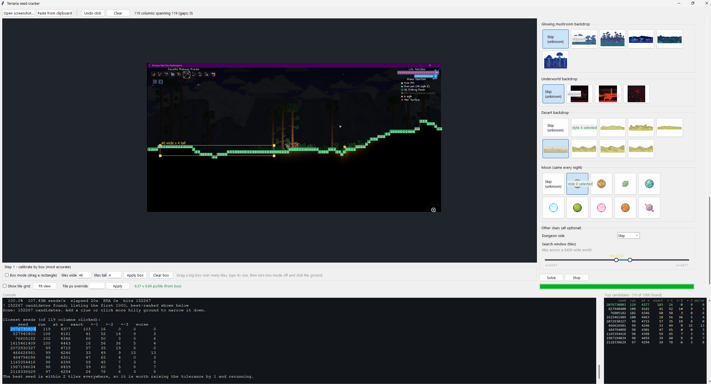
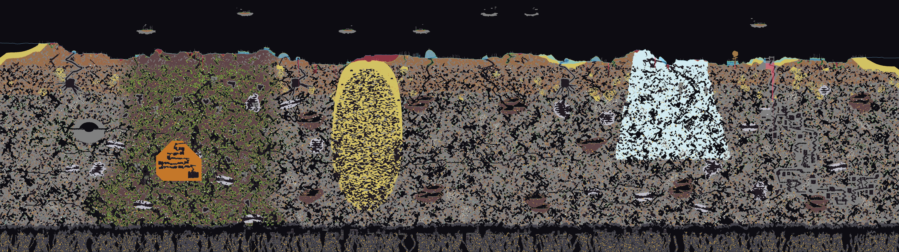

# Terraria seed cracker

Recovers a Terraria world seed from biome backgrounds and a height pattern.
Tested on Terraria 1.4.5.8.



## How it works

Terraria seeds are only 31 bits. `WorldFileData.TranslateSeed` applies
`Math.Abs`, so negative seeds collapse onto positives and the whole space is
2,147,483,647 values.

The search runs in two stages:

**Stage 1 (cheap, ~40 RNG draws per seed).** Tree style, biome background,
moon phase, dungeon side. These are rolled in `WorldGen.Reset` before
terrain generation, so testing them is cheap and can reduce candidates to
just one in under a minute on a 4060.

**Stage 2 (expensive, ~26,000 RNG draws per seed).** A surface height
pattern from a screenshot. Matched as relative deltas, so the
absolute Y is irrelevant, and slid across an X window. The position does
not need to be known either.

Because the terrain walk is sequential, positional uncertainty costs little
in runtime (the surface is generated regardless).

## Pick noisy ground if possible, but not big hills

The generator leaves ~73% of columns flat, so a flat stretch carries
essentially no information.

## Usage

```
python src/gui.py
```

1. Open a screenshot (or paste from clipboard).
2. Drag the box over any amount of visible tiles and enter the box's length
3. and height, to calibrate the grid.
4. Click or drag along the ground to create the height pattern.
5. Pick the tree style / backgrounds / moon sprite / e.t.c, all are
   skippable but this drastically reduces runtime. Be aware of the zoologist's
   items that change these sprites. Leave the optional left-to-right
   zone order blank unless you know the world size and how zones work.
7. Set the world size and any world flags / special seeds, then Solve.

## Build

The solver needs CUDA and MSVC on PATH:

```
nvcc -O3 -arch=sm_89 -o src/solve.exe src/solve.cu
```

Sprites are extracted from the game's own content files:

```
python src/extract_sprites.py
```

## Layout

```
src/tgen.h              exact 1:1 port of Terraria's worldgen RNG + TerrainPass
src/tgen_cu.cuh         same, marked up for CUDA
src/solve.cu            two-stage GPU solver (reads a JSON config)
src/gui.py              tkinter front end
src/extract_sprites.py  decodes XNB sprites into assets/
src/xnbread.py, lzx.py  XNB container + LZX decompressor
```

## Accuracy notes

`tgen.h` is a direct port, including the parts that are easy to get wrong:

- `UnifiedRandom` is a subtractive lagged Fibonacci generator.
- The C# constant `4.656612875245797E-10` is exactly `1/(2^31-1)`, not
  `1/2^31`. Integer division by `2147483647` is bit-identical; a `>>31` shift
  is not (it diverges once per ~156M draws, which is enough to derail a walk).
- `GenerateWorldSurfaceOffset` is a doubled switch with unbounded loops, and
  For The Worthy / drunk / remix take the first branch.
- Beach edges are RNG-derived, not fixed, and consume draws before terrain.
- The Constant never branches inside the terrain pass, but it short-circuits
  the iron and gold ore-tier guards in `WorldGen.Reset`
  (`(!dontStarveWorldGen || drunkWorldGen) && genRand.Next(2) == 0`). Two draws
  vanish and everything downstream shifts. Across 300 seeds that changes the
  stage-1 clues 100% of the time and the surface profile itself 35% of the
  time, so it has to be modelled even though no terrain code mentions it.
  Enabling drunk restores both draws, and the two flags together generate
  identically to drunk alone.

Difficulty (Classic/Expert/Master) does **not** affect terrain and is not an
input. For The Worthy, drunk, remix and The Constant do.

## Limits

- Only the surface terrain pass is modelled, hill passes, desertification and
  cave noise is not modelled, this needs to be considered when entering the
  height pattern. I attached an example below of the surface pass vs complete
  world gen.
  
- Majority of testing was done on normal seeds, I am not as confident
  with correctness on the supported special seeds.
